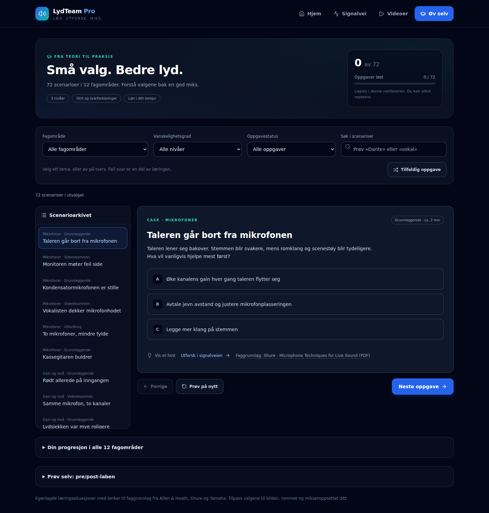

# Scenarioarkivet – 72 øvelser

Utvidelse av den publiserte portalen fra 3 til 72 scenarioer (69 nye), 18. oktober 2026. De tre opprinnelige ID-ene er beholdt slik at lagret progresjon fortsatt fungerer.

## Fagområder

| Fagområde | Scenarioer | Eksempler |
| --- | --- | --- |
| Mikrofoner | 6 | Avstand, retningskarakteristikk, 48 V, plassering og to mikrofoner |
| Gain og nivå | 6 | Headroom, delt preamp, digital trim og overstyring før mikseren |
| EQ og filtre | 6 | HPF, smale resonanser, maskering og de-esser |
| Dynamikk | 6 | Threshold, ratio, attack, release, gate og sidechain |
| Monitor og IEM | 6 | Pre/post, kildepunkt, talkback, balanse og feedback |
| Ruting og busser | 6 | Send-tilordning, DCA, grupper, matrix, I/O og Tie Lines |
| Effekter | 6 | Send/return, post-fade, decay, pre-delay, tempo og sløyfer |
| Scener og Show | 6 | Store/Recall, Global Safes, Recall Filter, Go og backup |
| dLive-arbeidsflyt | 6 | Active Mix, Sel, faderlag, PAFL/SIP, kopiering og DCA Spill |
| PA og akustikk | 6 | Dekning, delay, monosum, etterklang, kapasitet og sub/topp |
| Opptak og stream | 6 | Separat miks, Direct Outs, Dante og Virtual SoundCheck |
| Feilsøking | 6 | Manglende input, gruppemute, insert, isolering av feil og utgangskjede |

Nivåfordeling: 29 grunnleggende, 29 viderekomne og 14 utfordringer. Nivåene er pedagogiske vurderinger, ikke en produsentsertifisering.

## Læringsflyt

- Velg tema og nivå, søk etter situasjoner og filtrer på løste/uløste oppgaver. På mobil ligger søk og status under «Flere filtre».
- Hvert case har tre svaralternativer, egen forklaring for hvert valg, hint, læringspoeng ved riktig svar og lenke til faggrunnlag. Det finnes også en kobling til et relevant ledd i den eksisterende signalveien.
- Neste/forrige, repetisjon og tilfeldig valg gjør det mulig å øve innenfor utvalget. Tilfeldig valg prioriterer uløste og unngår å velge den aktive oppgaven når alternativer finnes.
- En nylig løst oppgave blir stående med forklaringen selv om uløst-filteret ellers ville fjernet den. Brukeren velger selv når neste oppgave åpnes.
- Løste oppgaver teller bare én gang. Repetisjon fjerner ikke lagret fullføring. Oversikten viser progresjon per fagområde.
- Progresjon er fortsatt lokal i nettleseren. Riktig svar etter hint eller flere forsøk teller som løst; siden måler ikke førstegangsprestasjon.

## Struktur og faggrunnlag

`src/data/practice/` har én modul per fagområde og et felles kilderegister. `practiceScenarios.js` samler innholdet. Den lette `practiceCatalog.js` inneholder temaer, nivåer og stabile scenario-ID-er for forsiden og validering av lagring. Spørsmålene lastes med øvingssiden, ikke med første sidevisning.

Casene er egenproduserte anvendelser av lydtekniske prinsipper. Kildelenkene peker til faggrunnlag fra Allen & Heath, Shure og Yamaha, ikke til identiske case formulert av produsentene. dLive-detaljer er kontrollert mot produsentens veiledning, blant annet skillet mellom Mix Source/pre-fade, Direct Out/Record Send, Scene/Show og vanlig PAFL/SIP. Konkrete innstillinger må tilpasses firmware, utstyr, kilder og rom.

## Verifikasjon

- `npm run lint`: bestått uten ESLint-feil eller advarsler.
- `npm test`: 12 av 12 bestått. Dekker innholdsintegritet, 72 unike ID-er, kilderegister, utforskingsmål, filterkombinasjoner, tilfeldig/neste valg og kompatibilitet med tidligere progresjon.
- `npm run build`: bestått. Eksisterende Browserslist-varsel om gammel database gjenstår.
- Playwright mot produksjonsbygget: 24 av 24 bestått i Chromium 153 med desktop- og mobilprofil. Alle 72 case er åpnet, besvart feil/riktig og kontrollert for individuell forklaring og kildelenke i begge profiler. Fullføring av hele arkivet bevares etter reload.
- Testene dekker også søk, tomme utvalg, siste uløste oppgave, repetisjon, fokus ved oppgavebytte, mobilarkiv, opprinnelige videoflyter, signalmoduler og bredder på 360/768/1024/1440 px.
- Desktop og mobilvisning er visuelt gjennomgått. På mobil er toppfeltet komprimert og avanserte filtre sammenfoldet.
- Første JS-pakke: 226,74 kB; øvingssiden lastes separat (79,98 kB, 25,26 kB gzip). Dette er byggstørrelser, ikke målt lastetid.

Nettlesertestene bruker samme separate Chromium-binær og midlertidige konfigurasjon som beskrevet i [refaktoreringsrapporten](refactoring.md). Ingen nye pakkeavhengigheter er lagt til.

Ikke verifisert: fysisk dLive-maskinvare, fysisk iPhone/iPad eller Safari/WebKit, faktisk YouTube-avspilling og en uavhengig fagfellevurdering av alle case. Nettlesertestene kontrollerer appens funksjon, ikke akustiske resultater.

## Skjermbilder

[Mobilvisning](screenshots/practice-expanded-mobile.png)
