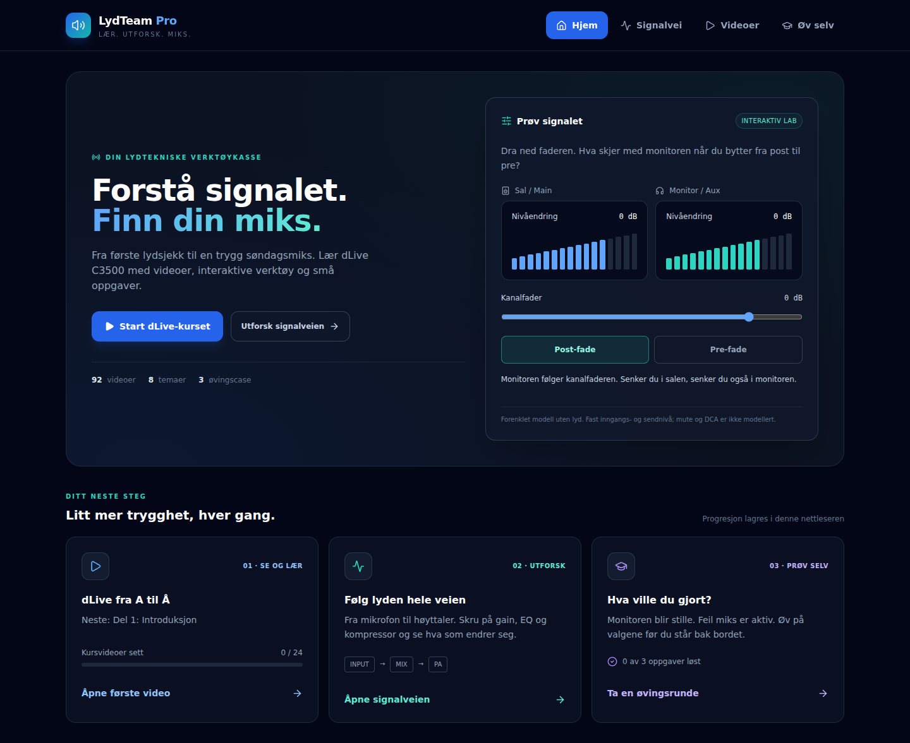
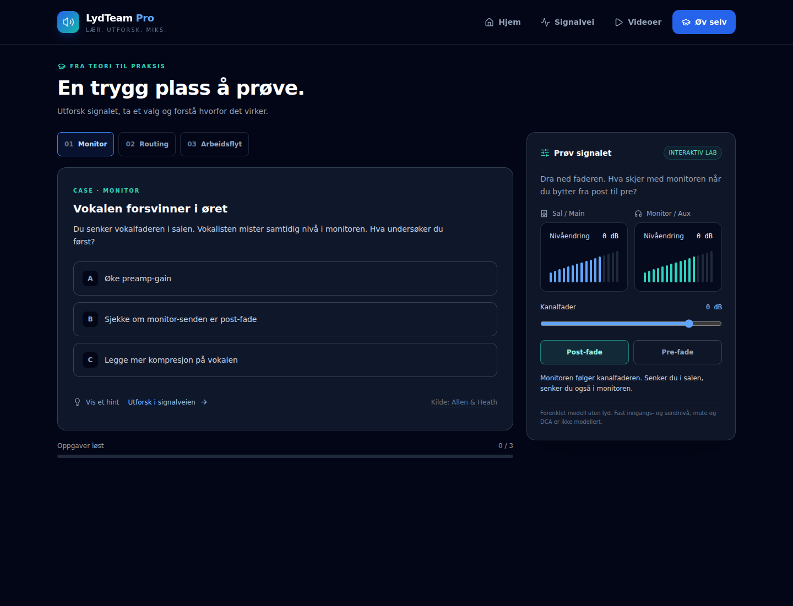

# Refaktorering og læringsflater

Utgangspunkt: `main` ved commit `71c586012df8ec98af69985c55f9458a381e3f23` (8. desember 2025). Gjennomført 18. oktober 2026.

Dette er rapporten fra den første refaktoreringen. Den senere utvidelsen fra 3 til 72 oppgaver er beskrevet i [scenarioarkivet](practice-scenarios.md).

## Endringene

`App.jsx` er redusert fra 3701 til 38 linjer. Videodata og signalveidata er flyttet uten innholdsendringer. Alle opprinnelige visualiseringer er beholdt som egne moduler. Hjem, videoarkiv, signalvei og øving er egne sider; de tre siste lastes først når de åpnes.

Det mørke blå/teal-designet er videreført. Forsiden har tydeligere læringssteg, progresjon og en pre/post-lab. Videoarkivet har ett felles avspillingsområde, søk på tvers av kategorier, filtre, favoritter, manuell sett-markering og neste video i serien. Tre korte case gir hint, konkrete svarforklaringer og lenker til relevant sted i signalveien.

Mobilmenyen har fire destinasjoner. Signalets detaljvisning bruker en native dialog med fokusavgrensning, lukkeknapp, Escape, tilbakeføring av fokus og låsing av bakgrunnsrulling. Sveiping støtter tilbake på flere nivåer, ignorerer kontroller og skiller horisontale sveip fra vertikal rulling. Eksisterende animasjoner er bevart og respekterer redusert bevegelse.

## Feil rettet under oppdelingen

- Ugyldig JSX-pil som stoppet ESLint i originalen.
- Ugyldig nestet CSS for mobile signalanimasjoner.
- Komponenter opprettet inne i render i monitor- og mixbus-visningene; de er nå stabile komponenter med eksplisitte props.
- Unødvendig synkron state-setting i detaljpanelets effekter; ny node/undermodul får isolert state, og aktiv video avledes direkte.
- Prosentverdier og strengaddisjon i SVG-stidata for mixbus-koblinger; bruker nå numeriske koordinater i en eksplisitt viewBox.
- SVG-linjer utenfor SVG-elementet i gate-visualiseringen.
- Skjult desktop-detaljpanel kunne eksistere samtidig med mobilpanelet; kun én detaljvisning er nå montert.
- Signalveikartet får intern horisontal rulling og et synlig rullehint. Mobil/nettbrett bruker liste og modal.
- Navigasjon, videokort, signalnoder, undermoduler og insertkort har native knapper. Dreieknotten støtter piltaster, Home/End og PageUp/PageDown.

## Faggrunnlag

De nye caseoppgavene bruker disse primærkildene:

- [Allen & Heath: Routing](https://support.allen-heath.com/hc/en-gb/articles/39795277687441-Routing)
- [Allen & Heath: Processing Screen](https://support.allen-heath.com/hc/en-gb/articles/39790636807825-Processing-Screen)

Den opprinnelige fagteksten og de opprinnelige videolenkenes innhold er videreført. Dette arbeidet innebærer ikke en full faglig revisjon av alle eksisterende råd eller simulatorers DSP-modeller.

## Verifikasjon

| Kontroll | Resultat |
| --- | --- |
| `npm run lint` | Bestått, ingen feil eller advarsler fra ESLint |
| `npm test` | 8 av 8 logikktester bestått |
| `npm run build` | Bestått med Vite 7.2.6; eksisterende Browserslist-database gir et oppdateringsvarsel |
| Playwright mot produksjonsbygg | 16 av 16 tester bestått i Chromium 153, desktop- og mobilprofil |
| Responsive bredder | 360, 768, 1024 og 1440 px, ingen horisontal overløp på siden |
| Originaldata | Videodata og signalveidata sammenlignet med startcommit: identiske JSON-verdier |
| Visuell kontroll | Forside på desktop/mobil, øvingsside og signalvei/detaljpanel gjennomgått |

Nettleserdekningen omfatter frem/tilbake, søk og filtre, favoritter og sett-markering etter reload, én aktiv videoavspiller, neste video, gjenopptakelse, case med feil/riktig svar, lenker fra case, alle signalnoder, prosesseringsmoduler og de fem insertverktøyene, tastaturstyrt gain, feilformatert/blokkert lagring, Escape, vertikal rulling og sveiping tilbake fra undernivå og fra skjermkanten. Ingen konsollfeil eller JavaScript-feil ble registrert i disse flytene.

Miljøets ordinære Playwright-nedlasting returnerte ugyldige arkiver. Testene ble derfor kjørt med en separat Chromium 153-binær fra `@sparticuz/chromium` og en midlertidig konfigurasjon. Denne miljøtilpasningen er ikke en appavhengighet og er ikke sjekket inn. Standardkonfigurasjonen i repositoriet bruker Playwrights vanlige Chromium-installasjon.

Første JavaScript-pakke er redusert fra 354,91 kB til 226,34 kB (omtrent 36 %), målt med samme låste Vite-versjon. Dette er en pakkestørrelse, ikke en måling av faktisk lastetid; total kode har økt med nye funksjoner, og CSS er noe større.

Nettlesertestene kontrollerer appens egne interaksjoner med erstattede YouTube-responser. De er ikke en bekreftelse på tredjepartsavspilling eller alle videolenkenes tilgjengelighet.

## Gjenstående manuell kontroll

- Faktisk videoavspilling, lyd, fullskjerm og autoplay i YouTube, særlig i iOS Safari.
- Fysisk iPhone/iPad og Safari/WebKit; Chromium med mobilprofil erstatter ikke testing på en fysisk enhet.
- Alle detaljer i eksisterende simulatorer og fagtekster opp mot mikserens aktuelle firmware og lokalt kirkeoppsett.
- Publisert hostingmiljø og virkelig miksermaskinvare; appen er ikke koblet til en fysisk mikser.

## Skjermbilder

[Mobilforside](screenshots/home-mobile.png)
